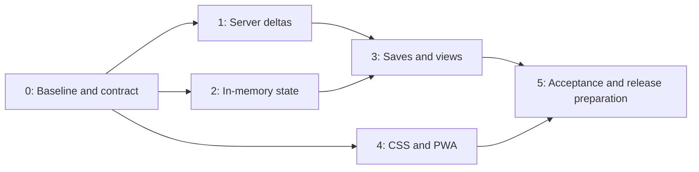

# Performance and Cache Roadmap

Read [context and binding contracts](00-CONTEXT.md) first. Documentation is complete when the fourteen handoffs are written and audited; no engineering stage becomes complete because its instructions exist.

## Stage order

| Stage | Deliverable | Gate before starting | Parallel work |
|---|---|---|---|
| 0 | Reproduction protocol, timing baseline, shared validated types | None | No dependent implementation |
| 1 | Transactional server deltas for every matrix operation | Stage 0 PASS | Stages 2 and 4 |
| 2 | Session-scoped state, read generations, serialized writes | Stage 0 PASS | Stages 1 and 4 |
| 3 | Forms, confirmations, views, history, refresh integration | Stages 1 and 2 PASS | Stage 4 |
| 4 | Verified CSS delivery, build identity, static/PWA behavior | Stage 0 PASS | Stages 1, 2, 3 |
| 5 | Integrated acceptance, comparison, release/rollback runbook | Stages 3 and 4 PASS | No independent product change |

## Ownership and integration

| Owner | Exclusive implementation area |
|---|---|
| Stage 0 | `shared/finance-sync.ts`, additive bootstrap identity in `server/app.ts`, timing helpers, baseline browser harness, package test script, build-info/update-safety interface stubs |
| Stage 1 | `server/app.ts`, `server/service.ts`, `server/categories.ts`, new server delta helper, server synchronization tests |
| Stage 2 | `src/lib/finance-store.ts`, store tests; no route or form edits yet |
| Stage 3 | `src/lib/api.ts`, route data, Layout/context, forms and page consumers, auto-refresh/history, integration tests |
| Stage 4 | Vite config, UpdatePrompt, build identity module, Caddy/Docker/static preparation script, static tests and CSS if reproduced |
| Stage 5 | Final integration and release runbook; no speculative feature additions |

Stage 0 hands server files to Stage 1 after its gate. Shared contract changes after Stage 0 require a documented amendment and rerunning affected checks; do not change wire types unilaterally. Stage 4 exposes build identity through `src/lib/build-info.ts`; Stage 3 owns Settings and renders that export, so the two must not edit Settings concurrently. Stage 4 owns static CSS; Stage 3 does not restyle recurring views.

Use separate branches/worktrees for simultaneous implementers. Default branch names are `codex/performance-cache-stage-N`. Inspect existing worktrees and reuse suitable ones; do not reset another session's changes. Integrate verified commits in dependency order. Merge Stage 1 and Stage 2 before Stage 3; Stage 4 may merge before or after Stage 3. Do not merge conflicting edits without rerunning the corresponding verification.

Verification sessions may prepare fixtures and expected outcomes in parallel, but verify a completed commit and record its SHA. A verification session reports failures; the implementation owner repairs them. Dependent work is gated on the latest repaired revision passing, not on an earlier report.

## Start a fresh session

1. Inspect repository instructions, `git status --short`, and the stage prerequisites/results.
2. Read context, roadmap, and both handoffs for the assigned stage.
3. Preserve `.env`, Google, unrelated `.idea/`, financial rules, and current user work.
4. Implement only the assigned stage or verify only its recorded revision.
5. Produce `stage-N-results.md` with evidence; mark blockers explicitly.
6. Update this checklist only after the stage has passed verification.

## Pending execution checklist

- [x] Stage 0 implementation completed
- [x] Stage 0 verification PASS (local; published/device checks blocked — see stage-0-results.md)
- [x] Stage 1 implementation completed
- [x] Stage 1 verification PASS (local)
- [x] Stage 2 implementation completed
- [x] Stage 2 verification PASS (local)
- [x] Stage 3 implementation completed
- [x] Stage 3 verification PASS (local; see stage-3-results.md)
- [x] Stage 4 implementation completed
- [ ] Stage 4 local verification PASS
- [ ] Published CSS reproduction/verification completed (may require device access)
- [ ] Stage 5 local acceptance PASS
- [ ] Physical-phone acceptance completed
- [ ] Deployment separately authorized
- [ ] Published acceptance PASS after authorized deployment

## Handoffs

| Stage | Implementation | Verification |
|---|---|---|
| 0 | [Implement](stage-0-implementation.md) | [Verify](stage-0-verification.md) |
| 1 | [Implement](stage-1-implementation.md) | [Verify](stage-1-verification.md) |
| 2 | [Implement](stage-2-implementation.md) | [Verify](stage-2-verification.md) |
| 3 | [Implement](stage-3-implementation.md) | [Verify](stage-3-verification.md) |
| 4 | [Implement](stage-4-implementation.md) | [Verify](stage-4-verification.md) |
| 5 | [Implement](stage-5-implementation.md) | [Verify](stage-5-verification.md) |

Gate interpretation: a reproducible local implementation may be verified separately from unavailable published/device checks. Those checks remain BLOCKED, and final published acceptance cannot pass until they are completed. Do not silently weaken the acceptance target or claim the reported CSS issue is fixed without evidence.
